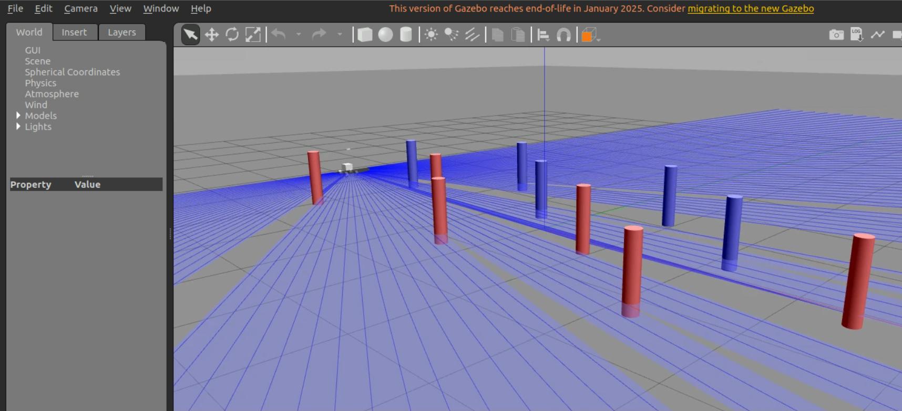

# Hackathon ROS2 — Slalom autonome du Limo

## Contexte

Vous êtes une équipe de robotique chargée de développer le logiciel de pilotage d'un robot
mobile Limo. Votre mission est de lui faire franchir, de manière autonome et en sécurité, un
parcours de slalom constitué de portes. Une porte est formée de deux plots. Le robot doit passer
entre les deux plots et enchaîner les portes dans l'ordre du parcours.

Le dépôt fournit un monde Gazebo d'entraînement et un exemple d'observation du lidar. La finale
se déroule sur un ou plusieurs **nouveaux mondes Gazebo**, non communiqués à l'avance. Ils
conservent le principe des portes formées de deux plots, mais peuvent modifier le nombre de
portes, leur position, leur écartement, l'orientation initiale du robot ou l'enchaînement du
slalom. Votre logiciel ne doit donc pas dépendre de coordonnées écrites en dur ni de la
connaissance d'un monde particulier.

Le transfert sur le robot réel peut être proposé lors de la restitution si le matériel et le temps
le permettent ; il ne remplace pas l'évaluation sur les mondes inédits.



*Illustration du monde d'entraînement Gazebo. Les faisceaux bleus représentent les mesures du
lidar utilisées pour détecter les plots.*

## Objectifs

À l'issue du hackathon, vous devrez être capables de :

- organiser une application ROS2 en plusieurs nœuds communicant par topics ;
- exploiter les mesures du lidar (`sensor_msgs/LaserScan`) ;
- appliquer un traitement de signal simple et robuste ;
- concevoir une commande de vitesse et de direction ;
- mettre en oeuvre une machine à états ;
- travailler en équipe avec Git et une méthode Agile légère ;
- présenter et justifier des choix techniques.

Vous n'avez pas à utiliser de navigation, de SLAM, de caméra ni d'intelligence artificielle.
Une solution simple, comprise et fiable sera mieux évaluée qu'une solution complexe non
maîtrisée.

## Mission fonctionnelle

Votre programme doit :

1. démarrer le Limo immobilisé ;
2. analyser le lidar pour identifier la prochaine porte ;
3. conduire le robot vers le milieu de cette porte ;
4. franchir la porte sans toucher les plots ;
5. rechercher la porte suivante ;
6. s'arrêter proprement à la fin du parcours ou lorsqu'une situation sûre ne peut plus être
   garantie.

Le Limo est commandé par un message `geometry_msgs/Twist` sur `/cmd_vel`. Les mesures du lidar
sont disponibles sur `/scan`. Le package `limo_slalom` fournit le monde d'entraînement et le
nœud `scan_observer`. Le README du dépôt explique comment créer un paquet ROS2, observer le
`LaserScan` et publier une commande. Les limites de vitesse et les dimensions du parcours seront
communiquées pendant le hackathon.

## Exigences de sécurité

La sécurité est prioritaire sur la performance.

- Le robot doit s'arrêter si un obstacle est détecté trop près dans la zone frontale.
- Le robot doit s'arrêter si les données lidar ne sont plus reçues ou sont trop anciennes.
- Un membre de l'équipe doit pouvoir demander l'arrêt à tout instant.
- Une seule partie de votre système publie la consigne finale sur `/cmd_vel`.
- Toute modification de gains ou de code est d'abord validée en simulation.
- Pendant les essais réels, une seule équipe utilise le robot à la fois et les personnes restent
  hors de la zone de déplacement.

Une collision, une perte de contrôle ou une intervention de sécurité arrête immédiatement la
manche.

## Contrat d'exécution de la finale

Votre livrable sera exécuté sur une machine distincte, avec un monde Gazebo nouveau détenu par
l'équipe enseignante. Le simulateur, les positions des portes et l'évaluateur ne seront pas
accessibles dans votre dépôt ni dans votre espace ROS2.

Votre application doit donc être une pile de décision autonome qui :

- consomme uniquement les interfaces ROS2 autorisées, en particulier `/scan` et `/clock` ;
- publie sa seule commande de mouvement sur `/cmd_vel` ;
- fonctionne sans fichier de monde, coordonnées de portes, service Gazebo ou topic de vérité
  terrain ;
- ne lance pas Gazebo, ne lance pas `limo_simulation` et ne crée pas le robot ;
- démarre avec `use_sim_time:=true` ;
- s'arrête avec une commande nulle si la perception est absente, invalide ou trop ancienne.

Le jury lance le monde, le Limo et l'évaluateur de son côté. Il relie ensuite les interfaces
capteurs/commande à votre application. Ne supposez pas que des topics Gazebo tels que
`/gazebo/model_states` sont disponibles.

## Attendus techniques

Votre système doit être découpé en composants dont la responsabilité est claire. Vous choisissez
les noms, les messages intermédiaires et la structure exacte, mais votre documentation doit
indiquer le rôle de chaque nœud et de chaque topic.

Les éléments suivants sont attendus :

- un prétraitement des données lidar : élimination des mesures invalides, sélection de secteurs
  angulaires et au moins un mécanisme de filtrage justifié ;
- une détection de porte fondée sur la géométrie des mesures lidar ;
- une estimation de la direction à suivre, par exemple à partir du milieu de la porte ;
- une commande qui transforme l'erreur de direction en vitesse linéaire et angulaire ;
- une machine à états explicite, par exemple attente, recherche, approche, franchissement,
  récupération et arrêt ;
- un superviseur de sécurité qui a priorité sur la commande nominale ;
- un fichier launch qui démarre l'ensemble de votre application.

L'architecture minimale recommandée sépare au moins la perception et la commande :

```text
/scan -> perception -> information de cible -> commande -> /cmd_vel
```

Le nœud de perception ne doit pas publier de commande de mouvement. Une seule sortie, le nœud de
commande ou de sécurité, publie sur `/cmd_vel`. Vous pouvez choisir les messages intermédiaires,
à condition de les documenter.

Vous pouvez utiliser une loi proportionnelle ou un PID simple. Les paramètres doivent être
centralisés et documentés. Pour chaque filtre ou régulateur, précisez le problème traité, les
paramètres retenus et un exemple d'observation ayant conduit à ce réglage.

## Déroulement indicatif — 32 heures

| Séquence | Durée | Résultat attendu |
|---|---:|---|
| Cadrage, prise en main et backlog | 3 h | Équipe organisée, dépôt Git et backlog initial |
| Exploration ROS2 et lidar | 5 h | Nœud d'observation et premières mesures exploitables |
| Traitement du signal et détection | 7 h | Détection validée sur plusieurs configurations simulées |
| Commande, états et sécurité | 7 h | Slalom partiel sûr en simulation |
| Intégration et robustesse | 5 h | Parcours complet sur le monde d'entraînement via un launch unique |
| Généralisation | 3 h | Tests sur des variantes de parcours sans coordonnées codées en dur |
| Finale et présentation | 2 h | Exécution sur mondes inédits et restitution |

Ce planning est une proposition : votre équipe peut le modifier dans son backlog si elle en
explique la raison.

## Travail en équipe avec une méthode Agile légère

Vous utiliserez un tableau de tâches simple, dans GitHub Projects, GitLab, un tableau physique
ou un fichier partagé. Chaque tâche doit être courte, formulée avec un verbe et posséder un
critère de fin vérifiable.

Exemples :

- « Publier la distance minimale dans le secteur frontal » ;
- « Afficher les données lidar filtrées » ;
- « Arrêter le robot quand le lidar ne répond plus » ;
- « Tester le franchissement d'une porte en simulation ».

Au début de chaque demi-journée, réalisez un point de 10 minutes :

1. qu'ai-je terminé depuis le dernier point ?
2. que vais-je faire maintenant ?
3. qu'est-ce qui me bloque ?

À la fin de chaque demi-journée, montrez une fonctionnalité qui fonctionne, même incomplète.
Mettez à jour le tableau : `à faire`, `en cours`, `à vérifier`, `terminé`. Une tâche n'est
terminée que si elle est testée et si son code est intégré à la branche principale.

Conservez dans votre dépôt un court fichier `RETROSPECTIVE.md` répondant à ces questions :

- qu'est-ce qui a bien fonctionné dans l'organisation ?
- quel problème avez-vous rencontré ?
- quelle action concrète avez-vous choisie pour la suite ?

## Utilisation de Git

Un membre crée un dépôt privé pour l'équipe et ajoute les autres membres. Ne travaillez pas
directement tous sur les mêmes fichiers sans vous coordonner.

Pour commencer :

```bash
git clone <url-du-depot>
cd <nom-du-depot>
git switch -c feature/nom-court
```

Une branche correspond à une tâche ou à une petite fonctionnalité. Avant de modifier des fichiers,
mettez votre branche à jour :

```bash
git switch main
git pull
git switch feature/nom-court
git merge main
```

Quand votre tâche fonctionne :

```bash
git status
git add <fichiers-modifies>
git commit -m "Ajouter la détection de porte"
git push -u origin feature/nom-court
```

Créez ensuite une *pull request* vers `main`. Un autre membre de l'équipe relit la modification,
vérifie que la fonctionnalité démarre et écrit au moins un commentaire avant la fusion. Ne
versionnez pas les dossiers ROS2 `build/`, `install/` et `log/`.

Les messages de commit doivent être brefs et décrire une action : `Ajouter ...`, `Corriger ...`,
`Tester ...`, `Documenter ...`. Faites de petits commits fréquents ; ils sont plus simples à
relire, tester et annuler.

## Livrables

Avant la finale, votre dépôt doit contenir :

- le ou les paquets ROS2 développés par l'équipe, avec toutes les dépendances déclarées dans les
  fichiers `package.xml` et `setup.py` ou `CMakeLists.txt` ;
- un `README.md` expliquant l'installation, la compilation et la commande de lancement ;
- un schéma de l'architecture ROS2 (nœuds, topics et flux principaux) ;
- les paramètres de réglage et leur signification ;
- un launch de finale permettant de démarrer la pile étudiante seule, sans monde ni robot, par
  exemple `ros2 launch <votre_package> final.launch.py use_sim_time:=true` ;
- le backlog final et `RETROSPECTIVE.md` ;
- une courte vidéo de la simulation ou des essais si le temps le permet.

Votre dépôt doit permettre au jury d'exécuter, depuis un workspace propre :

```bash
source /opt/ros/humble/setup.bash
colcon build --packages-select <votre_package>
source install/setup.bash
ros2 launch <votre_package> final.launch.py use_sim_time:=true
```

Le README doit indiquer le nom exact du package, la commande de lancement et les topics
consommés/publiés. Il ne doit demander aucune action manuelle après le lancement ni dépendre de
chemins absolus, de fichiers locaux hors dépôt ou de modules Python installés à la main.

Avant le rendu, l'équipe doit tester cette procédure dans un nouveau workspace ou sur une autre
machine. Le lancement de développement, qui démarre le monde d'entraînement, peut être conservé
mais ne sera pas utilisé par le jury.

La démonstration finale dure cinq minutes : lancement de la pile étudiante, exécution sur un
monde inédit et réponse aux questions techniques.

## Évaluation et classement

| Critère | Points |
|---|---:|
| Franchissement et généralisation sur les mondes inédits | 8 |
| Sécurité et comportement d'arrêt | 3 |
| Traitement lidar, commande et robustesse de la détection | 3 |
| Intégration ROS2, launch et qualité du dépôt Git | 2 |
| Organisation Agile, collaboration et traçabilité | 2 |
| Démonstration, explication et recul technique | 2 |
| **Total** | **20** |

### Protocole de finale

Chaque monde de finale est fourni au moment de l'évaluation. Les équipes lancent leur application
avec la commande `final.launch.py` documentée dans leur `README.md`. Les portes doivent être
franchies dans l'ordre du parcours. Une porte n'est comptée que si le robot passe entre les deux
plots sans collision ni intervention humaine.

Une collision, une sortie durable du parcours, une perte de contrôle ou une intervention de
sécurité arrête la manche. Les modalités pratiques (nombre de mondes, tentatives autorisées,
limite de temps et dimensions) sont annoncées avant la finale.

### Critère principal : portes franchies

Le classement compare d'abord le **nombre total de portes valides franchies** sur les mondes de
finale. Une équipe ayant franchi davantage de portes est toujours classée devant une équipe plus
rapide ayant franchi moins de portes.

### Critère secondaire : vitesse moyenne entre deux portes

En cas d'égalité sur le nombre de portes valides, le départage utilise la vitesse moyenne entre
deux portes successives valides. Pour un intervalle, l'arbitre calcule :

```text
vitesse moyenne = distance entre les centres des deux portes / durée entre leurs franchissements
```

La valeur de départage est la moyenne des intervalles valides de la manche. Elle n'est calculée
que lorsqu'au moins deux portes ont été franchies. La vitesse est donc un critère secondaire :
elle ne compense jamais une porte non franchie.

Les 8 points de performance reflètent ce même ordre de priorité : franchissement fiable et
généralisation avant vitesse. Une solution sûre, expliquée et robuste sur un monde inédit sera
valorisée davantage qu'une solution réglée uniquement pour le monde d'entraînement.
